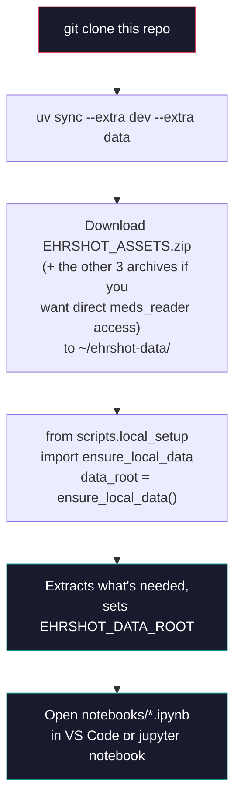

# Leakage-Safe Patient Graphs for Few-Shot Clinical Prediction


This is the working repo for a semester research project (CIS 4930 / CAI 5155, Network Analysis and Machine Learning with Graphs, University of South Florida, Fall 2026), aimed at a real publication afterward.

**The question:** does a leakage-safe patient-similarity graph genuinely improve a pretrained clinical foundation model's (CLMBR) few-shot predictions on EHRSHOT, and does the size of that improvement track graph homophily — or does it only show up when the graph is allowed to see the future?

*(This line gets replaced with the actual finding once we have one.)*

## Data access — read this first

This repository contains **no patient data, ever** — not raw, not aggregated-but-still-per-patient, nothing. EHRSHOT is distributed by Stanford under a Data Use Agreement. Full details, including how to get your own access, are in [`DATA_ACCESS.md`](DATA_ACCESS.md). Short version: get your own DUA-approved copy, then:

```bash
export EHRSHOT_DATA_ROOT=/path/to/your/local/copy
```

Every script reads from that environment variable — never a relative path from this repo. That's the whole rule, and it's the one thing in this project that isn't negotiable.

## Can the public site + paper really be safe if the data never leaves your laptop?

Yes, and here's the actual mechanism, not just a promise:

1. **`results/aggregate/`** is the *only* thing anything public ever reads — not the raw data, not `EHRSHOT_DATA_ROOT`, nothing else. It holds summary statistics and metrics (AUROC tables, homophily numbers, degree distributions) with no patient-level rows in it.
2. **`results/per_patient/`** is gitignored completely — anything with one row per patient stays local, always, and CI fails the build if it's ever staged.
3. The eventual Quarto site's pages will only ever import from `results/aggregate/*.csv`. They never touch `EHRSHOT_DATA_ROOT`. That means the site can be rendered in GitHub Actions on a runner that **has no access to the data at all** — if a page ever tried to read patient-level data, the build would simply fail, because the data isn't there to read. That's a structural guarantee, not a policy someone has to remember to follow.
4. One more thing worth knowing, since it's counter-intuitive: **GitHub Pages sites are public even when the source repository is private.** Repo privacy protects the code and the process; it does not protect anything you publish to Pages. So the safety of the public paper/site comes entirely from point 1–3 above, not from the repo being private. Keeping the repo private for now is about giving us room to fix a mistake before it's ever been cloned — it isn't what makes the published site safe.

One extra thing worth doing once we're stratifying by sex/ethnicity, since it can matter even for aggregate numbers: don't publish a subgroup cell smaller than ~10–20 patients. A tiny cell (e.g. "3 patients, 2 positive") is technically aggregate but can still be identifying in a small cohort. Worth a quick manual check before any table with a demographic breakdown goes on the site.

## Repo layout

```
.
├── .github/
│   └── workflows/
│       ├── ci.yml             lint + smoke test on every push/PR
│       └── data-guard.yml     fails the PR if anything data-shaped got added
├── .github/PULL_REQUEST_TEMPLATE.md   the data-safety checklist every PR sees
├── src/ehrgraph/              the installable package — this is where the real code goes
│   ├── data/                  meds_reader wrappers, label + split loaders
│   ├── graphs/                vectorization, similarity, sparsify, the 3 graph conditions
│   ├── netstats/               centrality, communities, homophily, Dirichlet energy
│   ├── models/                lr, mlp, propagation, gcn, gat, sage
│   ├── eval/                  few-shot harness, metrics, bootstrap
│   └── viz/                   figure functions (aggregate inputs only)
├── tests/
│   └── test_smoke.py          confirms the package imports; real tests land as graphs/censoring get built
├── scripts/
│   ├── local_setup.py         current default — extracts from ~/ehrshot-data/, sets EHRSHOT_DATA_ROOT
│   ├── colab_setup.py         Colab fallback (Drive or direct upload), kept tested but not primary
│   └── dismantle_data.py      splits EHRSHOT_ASSETS.zip, only needed for the Colab direct-upload fallback
├── notebooks/                 Project 1 computation happens here — see notebooks/README.md
├── r-viz/                     R + ggplot2, final report figures only — reads results/aggregate/ exclusively
├── data/
│   ├── README.md              committed — points to DATA_ACCESS.md
│   └── checksums.txt          committed — sha256 of the expected dataset files, so two people can confirm
│                               they have the same version without transmitting the data
├── results/
│   ├── aggregate/             committed — metrics/figures only, the sole input to the public site and r-viz/
│   └── per_patient/           gitignored — never committed, ever
├── .gitignore  .pre-commit-config.yaml  .vscode/
├── LICENSE  DATA_ACCESS.md  CITATION.cff
├── pyproject.toml  uv.lock  Makefile
```

**Not here yet, on purpose:** `configs/`, `site/`, `docs/adr/`. Each one gets created with a single command the moment there's an actual file to put in it — `site/` when the Quarto build actually begins. An empty folder that exists only to look organized isn't worth the confusion of browsing past it with nothing in it.

## Computation happens locally (current — Colab/Redivis kept as fallback)

Project 1 runs entirely on your own machine now. The original plan routed everything through Colab specifically because of an assumption ("not enough local compute") that turned out to be wrong — a normal laptop (confirmed: 8 threads, 32GB RAM) handles this comfortably; the graphs here top out around ~3,800 nodes.

**Setup, one time:**



Every notebook's first cell calls `ensure_local_data()` (`scripts/local_setup.py`) — no Drive, no upload widget, no waiting. `meds_reader` itself installs and runs cleanly on Linux/macOS (confirmed Sep 20) — if it ever doesn't on your setup, that's the one thing worth flagging early.

**Colab is not gone, just demoted.** `scripts/colab_setup.py` and `scripts/dismantle_data.py` still work and are still tested (`tests/test_colab_setup.py`, `tests/test_dismantle_data.py`) — useful if local compute is ever genuinely insufficient (a serious Project 2 GNN sweep, maybe). See `notebooks/README.md` for that path. Redivis is still a live open question (issue #23) but no longer something Project 1 is waiting on.

**The DUA rules are unchanged by any of this** — local, Colab, or Redivis, the data still never gets committed, never gets exposed publicly, and only aggregate output leaves this machine at all. See [`DATA_ACCESS.md`](DATA_ACCESS.md).

## Install

```bash
git clone https://github.com/patient-graph-lab/ehrshot-patient-graphs.git
cd ehrshot-patient-graphs
uv sync --extra dev --extra data      # installs everything, including meds_reader + jupyter
uv run pre-commit install
uv run python -m ipykernel install --user --name ehrshot-patient-graphs
```

Then, in any notebook, the first cell is always:

```python
from scripts.local_setup import ensure_local_data
data_root = ensure_local_data()   # extracts from ~/ehrshot-data/, sets EHRSHOT_DATA_ROOT
```

VS Code: open the repo folder, install the recommended extensions when prompted (Python, Jupyter, R — already listed in `.vscode/extensions.json`), select the `.venv` interpreter, and notebooks just work. For the R visualization step, see `r-viz/README.md`.

## Working on this repo

- Short-lived branches off `main`, merged via PR, squash-merged. `pre-commit install` runs `ruff` and a data-file guard locally before anything reaches GitHub — that's the check that actually protects the repo; CI's `data-guard` is the backstop, not the first line.
- If you touch graph construction, time-censoring, or splits: add a test, and say in the PR whether it invalidates any results generated earlier. That one sentence has saved more than one research project from citing a number a later bug quietly broke.
- Tag submission commits (`project1-submission`, `project2-submission`) at the exact commit whose output got submitted — free, and it's the difference between "let me check" and "let me re-derive this" if a figure looks off in December.

## How to cite

See [`CITATION.cff`](CITATION.cff).

## License and data terms

Code is Apache-2.0 ([`LICENSE`](LICENSE)). That covers code only — [`DATA_ACCESS.md`](DATA_ACCESS.md) has the data terms, which are separate and non-negotiable regardless of what the code license says.
