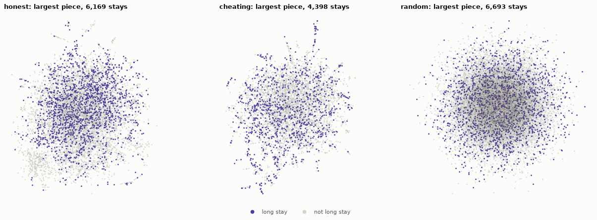

# Similar Patients, Shared Outcomes

Patient similarity networks and information leakage in EHRSHOT.
Web Search and Data Mining (WSDM) conference 

Sanjay Malla, Quade Leonard, Ean Stedham.


## Overview

We turn hospital records from Stanford's EHRSHOT dataset into networks. Each node is a hospital stay, and two stays are linked when the patients' diagnosis histories are very similar. We then use classical network analysis to answer two questions:

1. **Do linked stays share outcomes?** We look at two outcomes: a hospital stay of 7 days or more, and a new diagnosis of high blood pressure within a year.
2. **What happens if the network accidentally uses information from the future?** This mistake is called *information leakage*. We compare an *honest* network (only diagnoses known at prediction time), a *cheating* network (the full record, future included) and a *random* network.

Main findings:

- Honest networks are tightly clustered, and linked stays share outcomes far more often than chance.
- Leakage depends on the question. It barely changes the long-stay network. For high blood pressure, the future record contains the diagnosis itself, so the cheating network looks better than it should.
- A disease-to-disease network recovers recognisable groups of conditions, such as heart failure, sepsis and respiratory failure.



## Setup

This branch (`trimmed-dataset`) uses only the course's trimmed OMOP dataset. You need your own approved copy of it (`ehrshot.zip`).

There are two ways to set up. Both give you the same environment, with the exact package versions pinned in `uv.lock`.

- **Option A: Linux, one command.** `setup.sh` does everything.
- **Option B: VS Code, step by step.** Works on Windows, macOS and Linux.

### Option A: Linux, one command

Install [uv](https://docs.astral.sh/uv/) once:

```bash
curl -LsSf https://astral.sh/uv/install.sh | sh
```

Then:

```bash
git clone https://github.com/patient-graph-lab/ehrshot-patient-graphs.git
cd ehrshot-patient-graphs
./setup.sh ~/Downloads/ehrshot.zip
```

The script:
1. creates the Python environment in `.venv/` (uv downloads a matching Python if you don't have one);
2. installs the pre-commit safety checks;
3. unzips the data into `data/omop/`;
4. checks that the four required tables are there;
5. runs the unit tests.

Every step is commented in the script, and it is safe to run again.

Optional flags:
- `--docker` also runs the full check in a clean container (see [Reproducing the results](#reproducing-the-results)).
- `--report` also builds the report PDF.

Then open the notebooks with `uv run jupyter lab`, or in VS Code from step 6 of Option B.

### Option B: VS Code (Windows, macOS, Linux)

**1. Install the tools** (once per computer):
- [VS Code](https://code.visualstudio.com/) and [Git](https://git-scm.com/downloads).
- uv:
  - Windows (PowerShell): `powershell -ExecutionPolicy ByPass -c "irm https://astral.sh/uv/install.ps1 | iex"`
  - macOS / Linux: `curl -LsSf https://astral.sh/uv/install.sh | sh`

  Close and reopen VS Code afterwards so it can find `uv`.

**2. Get the code.** In VS Code, press `Ctrl+Shift+P` (`Cmd+Shift+P` on macOS), run **Git: Clone**, paste `https://github.com/patient-graph-lab/ehrshot-patient-graphs.git`, and open the folder when asked.

**3. Install the extensions.** When VS Code offers to install the recommended extensions, accept. You need **Python** and **Jupyter** (both by Microsoft).

**4. Create the environment.** Open a terminal (**Terminal > New Terminal**) and run:

```bash
uv sync --extra dev
uv run pre-commit install
```

This creates a `.venv` folder in the project with everything installed.

**5. Add the data.** Unzip `ehrshot.zip` so that the CSV files sit directly in `data/omop/`, not in a subfolder.
- Windows: right-click the zip, choose **Extract All**, and pick the `data\omop` folder inside the project.
- macOS / Linux: `unzip ~/Downloads/ehrshot.zip -x '__MACOSX/*' -d data/omop`

Check that you can see `data/omop/person.csv`, `visit_occurrence.csv`, `condition_occurrence.csv` and `concept_ancestor.csv`. The folder is gitignored, so the data can never be committed.

**6. Run the notebooks.**
1. Open `notebooks/01_data_and_labels.ipynb`.
2. Click **Select Kernel** (top right), then **Python Environments**, and choose **.venv**.
3. Click **Run All**.

Then do the same for `02` to `06`, in order. All six take about 10 minutes.

**If something goes wrong:**

| Problem | Fix |
|---|---|
| `Couldn't find person.csv ...` | The CSVs are in a subfolder. Move them so they sit directly in `data/omop/`. |
| `ModuleNotFoundError: ehrgraph`, or VS Code offers to install `ipykernel` | The wrong Python is selected. Click the kernel name (top right) and choose **.venv**. |
| `.venv` doesn't appear in the kernel list | Run `uv sync --extra dev` again in the terminal, then reload VS Code (**Developer: Reload Window**). |
| `uv: command not found` | Close and reopen VS Code (or your terminal) after installing uv. |

Results are written to `results/aggregate/` (summary CSVs) and `results/aggregate/figures/`.

| Notebook | Contents |
|---|---|
| `01_data_and_labels` | The data, the two outcomes, and the ICD-9 to ICD-10 switch in 2015 |
| `02_long_stay_networks` | Honest, cheating and random networks for long stays |
| `03_high_blood_pressure_networks` | The same for new high blood pressure |
| `04_disease_trajectories` | Which diseases tend to follow which, and how they group |
| `05_spreading_and_partitioning` | SIR spreading, cascades, and spectral partitioning |
| `06_wrap_up` | Both outcomes side by side, plus robustness checks |

### Reproducing the results

```bash
uv run pytest            # unit tests on synthetic data; no dataset needed
make docker-check        # Linux/macOS: everything again in a clean container
```

`make docker-check` builds a clean container and runs the tests and all six notebooks in it. It then confirms that every result matches the committed ones. The data is mounted read-only, and the container has no network access. It needs Docker, or Podman with `DOCKER=podman`. If your data isn't in `data/omop/`, add `DATA=/path/to/data`.

### Building the report

```bash
make report              # report/main.pdf (needs a LaTeX installation)
make overleaf            # report/overleaf.zip for Overleaf
```

To work on the report in Overleaf:
1. Run `make overleaf`.
2. In Overleaf, choose **New Project > Upload Project** and select `report/overleaf.zip`.

The zip contains `main.tex`, one file per section, the bibliography and all figures.

## Repository layout

```
data/omop/          course CSV files (local only, never committed)
notebooks/          analysis notebooks 01-06; executed/ holds copies with outputs
src/ehrgraph/       Python package: data loading, graph building, network measures, figures
results/aggregate/  summary CSVs and figures (no patient-level data)
report/             LaTeX report
tests/              unit tests on synthetic data
docs/               results file format and progress log
scripts/            notebook publishing and reproducibility checks
```

## Data use

The dataset is private and covered by a data use agreement:
- The repository contains only code, summary numbers and figures.
- Each team member uses their own approved copy, and the data stays on that person's computer.
- Executed notebooks are scanned for patient identifiers before they are committed, and CI checks every pull request.

See [`DATA_ACCESS.md`](DATA_ACCESS.md) for details.

## License and citation

Code: [Apache-2.0](LICENSE). Citation: [`CITATION.cff`](CITATION.cff). EHRSHOT: Wornow et al., *EHRSHOT: An EHR Benchmark for Few-Shot Evaluation of Foundation Models*, NeurIPS 2023 ([arXiv:2307.02028](https://arxiv.org/abs/2307.02028)).
